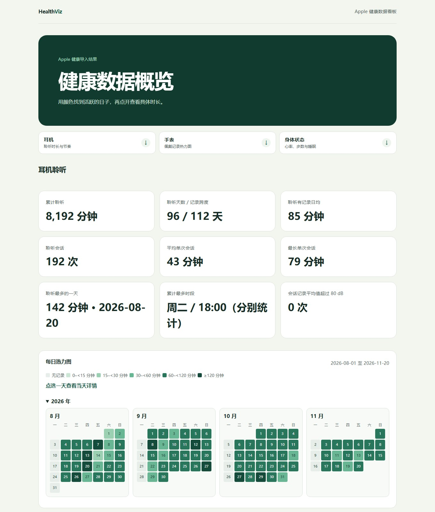
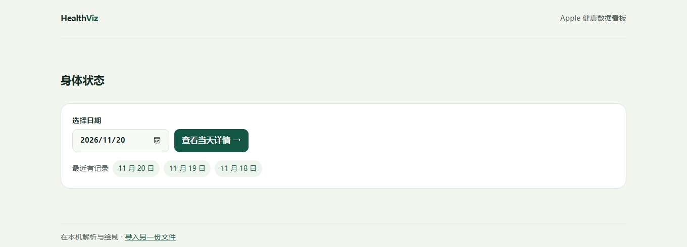

<div align="center">

# HealthViz

**把你的 Apple Health 数据，变成一眼能看懂的可视化**

*Turn your Apple Health data into visualizations you can actually read*

[](https://www.python.org/)
[](LICENSE)
[]()

**纯本地运行 · 零依赖 · 数据不上传任何服务器**
*Runs locally · Zero dependencies · Nothing leaves your machine*

</div>

---

## 界面预览 · Preview





## 它做什么 · What it does

**中文**

从 iPhone 健康 App 导出的数据里，提取并可视化：

- **耳机聆听** — 每天听了多久、什么时候听、单次最长多久、一个月里哪几天在听
- **手表佩戴估算** — 根据站立记录查看每天哪些小时有记录，以及当天的锻炼与身体状态
- **身体状态** — 按天展开导出中可用的心率、步数、睡眠、活动能量、体重等指标

点每日热力图中的日期可打开独立的当天详情页，集中查看耳机、手表和身体状态。点「返回健康数据概览」即可回到原来的热力图位置。耳机显示推算出的聆听起止，手表显示有站立记录的小时范围。多个设备的步数等累计值按来源分别显示，避免重复相加。

**English**

Extracts and visualizes three groups of data from your iPhone Health export:

- **Headphone listening** — how long each day, when during the day, longest single session, which days of the month
- **Apple Watch** — estimated wear windows based on recorded stand hours, plus workout records
- **Body metrics** — daily readings with plain-language Chinese explanations and tips

Select a heatmap date to open its daily details, or use the calendar and recent-date shortcuts under Body Metrics. Use the back link to return to the overview.

## 快速开始 · Quick start

```bash
git clone https://github.com/xialin99/health-viz.git
cd health-viz
python3 app.py
```

**中文**：终端会打印一个网址，浏览器自动打开。把健康数据 zip 拖进去，等解析完成。

**English**：A URL is printed in the terminal and your browser opens automatically. Drop the health export zip onto the page and wait for parsing.

Windows：解压项目后，在资源管理器中双击 **Start HealthViz.cmd**。它会寻找 Python 3.8+，启动服务并自动打开默认浏览器。使用时保留启动窗口。

macOS / Linux：安装 Python 3.8 或更新版本，在终端进入解压后的项目目录并运行 `python3 app.py`。无需登录。

Download the current version from [GitHub](https://github.com/xialin99/health-viz/archive/refs/heads/master.zip).

> 不需要 `pip install`，不需要 Docker，不需要数据库。Python 3.8+ 即可。
> No `pip install`, no Docker, no database. Just Python 3.8+.

## 怎么导出健康数据 · How to export

**中文**

1. iPhone 打开「健康」App
2. 点右上角头像
3. 拉到最下面，点「导出所有健康数据」
4. 等几分钟，得到 `export.zip`（通常几十到几百 MB）
5. 拖到页面上

**English**

1. Open the **Health** app on iPhone
2. Tap your **profile picture** (top right)
3. Scroll to the bottom, tap **Export All Health Data**
4. Wait a few minutes for `export.zip` (usually tens to hundreds of MB)
5. Drop it onto the page

## 数据安全 · Privacy

**中文**：所有解析都在你的机器上完成。ZIP 暂存于系统临时目录，解析结束后删除。解析和图表绘制都在本机完成。

**English**: All parsing happens on your machine. The uploaded ZIP is deleted after processing. Parsing and charts run locally without a CDN.


## 项目结构 · Structure

```
health-viz/
├── app.py       # HTTP 服务、文件上传、任务调度  /  server, upload, dispatch
├── parser.py    # 解析 Apple Health XML           /  parse the XML
├── analyze.py   # 切分会话、统计佩戴               /  sessions & wear stats
├── details.py   # 按天整理设备时间线和身体指标      /  daily details
├── render.py    # 生成 HTML                       /  HTML rendering
├── LICENSE      # MIT
└── README.md
```

## 工作原理 · How it works

**中文**

**耳机聆听**：健康数据里每条 `HeadphoneAudioExposure` 记录带开始/结束时间。把相邻间隔 ≤ 2 分钟的记录合并成一次「聆听会话」，只累加有记录的时间，跨小时或午夜时分别汇总。

**手表佩戴**：用 `AppleStandHour` 反推。Apple Watch 每个整点记录一次「站没站」，只有戴上才记录。每个有记录的小时计为 1 个估算佩戴小时；缺少记录不能据此判断没戴。

**English**

**Headphone listening**: each `HeadphoneAudioExposure` record carries start/end times. Records with gaps ≤ 2 minutes are merged into one "listening session", while only recorded intervals count toward duration. Time is split across hour and day boundaries.

**Watch wearing**: derived from `AppleStandHour`. Apple Watch logs a stand/idle event at every hour — only when worn. Each hour containing a record counts as one estimated wear hour. Missing records do not establish that the watch was off the wrist.

## 支持的数据类型 · Supported data

| 健康类型 / HealthKit type | 用途 / Purpose |
|---|---|
| `HeadphoneAudioExposure` | 耳机聆听时长 / headphone listening time |
| `AppleStandHour` | 手表佩戴时长 / watch wearing time |
| `Workout`, `AppleExerciseTime` | 锻炼记录和时长 / workout sessions and exercise time |
| `HeartRate`, `RestingHeartRate`, `HeartRateVariabilitySDNN` | 心率、静息心率和心跳间隔变化 / heart rate, resting heart rate and HRV |
| `StepCount`, `DistanceWalkingRunning`, `ActiveEnergyBurned` | 步数、步行和跑步距离、活动消耗 / steps, walking and running distance, active energy |
| `SleepAnalysis`, `BodyMass` | 睡眠和体重 / sleep and body weight |
| `RespiratoryRate`, `OxygenSaturation` | 呼吸次数和血氧 / respiratory rate and blood oxygen |

## 常见问题 · FAQ

**Q: 解析很慢？ / Parsing is slow?**

A: 健康数据 XML 通常几百 MB 到 1 GB+，完整解析需要几分钟，取决于记录量和机器性能。

A: The XML is usually hundreds of MB to 1 GB+. Full parsing takes a few minutes depending on record count and hardware.

**Q: 需要 Apple Watch 吗？ / Do I need an Apple Watch?**

A: 耳机数据只需要 iPhone。手表佩戴数据需要戴 Apple Watch。

A: Headphone data only needs an iPhone. Watch-wearing data requires an Apple Watch.

**Q: 支持 Windows / macOS / Linux 吗？ / Which platforms?**

A: 都支持，只要装了 Python 3.8+。

A: All of them, as long as Python 3.8+ is installed.

**Q: 端口被占用了怎么办？ / Port in use?**

Windows PowerShell:

```powershell
$env:PORT = '8888'
python app.py
```

macOS/Linux: `PORT=8888 python3 app.py`

## 许可证 · License

[MIT](LICENSE) © 2026 forest
